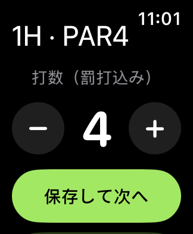

# Fairway — iPhone / Apple Watch ゴルフスコア

2026-10-24 初版0.1.0。対象は iPhone 16e と Apple Watch Series 7。最低要件はiOS 17 / watchOS 10。実機のOSバージョンは未確認です。

**ネイティブテスト20件・失敗0件、iPhoneとWatchの実機向けビルドが成功し、Watch同梱の未署名IPAを生成しました。** [成功したビルド](https://github.com/iwamoto0414yuuki-droid/Fairway/actions/runs/40087585760)。実機でのSideStore導入・端末間同期・GPS・電池消費は未検証です。

ローカル配布ファイルは `release/Fairway-0.1.0-unsigned.ipa`（508,840 bytes）、[導入手順](INSTALL.md)、[検証結果](docs/RESULTS.md)。



## 実装した機能

- 9 / 18ホールのラウンド作成、打数、任意のパット数、罰打込みの入力。
- ホール別修正、入力取消、未入力を除いた合計・対パー、終了・再開・履歴。
- iPhoneでコース検索、航空写真をタップして各グリーン中央を登録、PARの設定。
- Watch / iPhoneの「距離を更新」で単発GPS測位、グリーン中央までの直線距離（yd）。
- 測定時刻・報告精度を表示。最大20秒で測位を打ち切り、画面を離れると停止。
- スコアの端末内保存、WatchConnectivityによる保存時転送、切断中のキュー。
- 履歴から同じコースのPARとグリーン位置を再利用。iPhoneからスコアをCSVテキストで共有。

GPSは常時更新しません。位置未登録・権限拒否・取得失敗でもスコアは記録できます。全国のゴルフ場データベース、グリーン前後距離、高低差補正、ホール自動判定、スイング検知、HealthKitは初版に含めません。

## 操作

1. iPhoneで「ラウンドをはじめる」→ コース名・9/18ホール。
2. 各ホールを開き「PAR・グリーン位置を設定」。検索でゴルフ場へ移動し、航空写真を拡大してグリーン中央をタップ→保存。初期PARは全ホール4なので必ず実際の値へ変更。
3. Watchにラウンドが届いたら開く。届かない場合、両端末でアプリを開き、iPhoneのラウンド内で「このラウンドを再送」。WatchConnectivityは即時到着を保証しません。
4. 「スコアを入力」→打数の−/＋→「保存して次へ」。Watchの距離確認は「GPS距離」から開いて「距離を更新」。画面は縦スクロールできます。閉じる前に必ず保存してください。
5. ラウンド終了時にカードを確認して終了。未入力がある場合も確認して終了できます。

距離は手動登録位置への測定時点の概算です。ピンの実位置や高低差は反映しません。GPS精度が50mを超える場合や15秒より古い測位結果は表示しません。50m以下でも測定誤差があるため表示された精度を確認してください。2km以上離れた登録先は距離の代わりに位置確認を表示します。

## Macでの確認

XcodeとXcodeGenが必要です。ユーザーの承認を得て[公開リポジトリ](https://github.com/iwamoto0414yuuki-droid/Fairway)を作成し、GitHub ActionsのMacでビルド・テストしました。

```sh
brew install xcodegen
xcodegen generate
open Fairway.xcodeproj
```

Fairway / FairwayWatchのSigning & Capabilitiesで同じ開発チームを指定し、ペアリングした実機を選択します。Bundle IDを変更する場合は、iPhone ID、Watch IDのプレフィックス、WatchのWKCompanionAppBundleIdentifierの3箇所を合わせてください。

SideStore向けの未署名IPA作成:

```sh
bash scripts/build_ipa.sh
```

出力は `build/Fairway-0.1.0-unsigned.ipa`。スクリプトはWatchアプリの同梱、実機プラットフォーム、親子Bundle IDを検査します。**同梱確認だけではSideStoreでのWatch導入成功を保証しません。再署名後のID整合とWatchへのインストールを実機で確認する必要があります。**

GitHub Actions定義は `.github/workflows/ios.yml`。公開リポジトリのみ実行する制限があり、非公開リポジトリの有料Mac実行を自動で始めません。公開する前にユーザーの同意が必要です。ローカルのMacであれば公開せずビルドできます。

## 保存・同期の仕様

- Application Support内のJSONへatomic write。保存成功後に送信。読込破損時は上書きを停止して原本を保護。
- 各ホールのスコア / PAR / グリーン位置と終了状態を別々に更新番号で管理。
- 別ホールのオフライン編集はマージ。同一項目の同時編集は論理カウンター、同値なら端末ID順で決定。実時刻の後勝ちではありません。
- 画面を開いた後に同じホールのスコアを受信した場合、古い編集内容での保存を止めて再確認を要求。
- 転送は保存時のみ（起動時に最新ラウンドも再送）。転送失敗時は再送ボタンを使用。転送完了表示は相手側ディスクへの保存確認ではありません。
- ラウンド削除・データ復元UIは未実装。アプリ削除でローカルデータが失われる可能性があります。

## 検証

テストは合計20件です。`CoreTests.swift` の15件は合計・未入力・境界・距離計算・重複/順序逆転/同時編集/取消の同期・JSON往復・転送サイズ、`StoreTests.swift` の4件は保存・再読込・古い編集の拒否・破損データ保護・コース再利用、`ScreenTests.swift` の1件はiPhoneの3画面描画を検証します。画像は空白でないことも確認します。実行にはXcodeが必要です。

詳しい調査は [調査と設計](docs/RESEARCH.md)、実機確認は [検証計画](docs/VALIDATION.md)。
