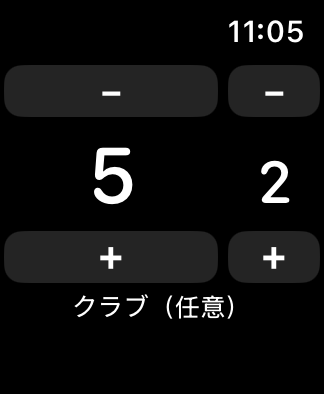

# Fairway — Watchで使う最小ゴルフカウンター

2026-10-25。現行の開発版は0.3.0。対象はiPhone 16e／Apple Watch Series 7、最低iOS 17／watchOS 10です。

Watchへの導入を優先し、GPS・地図を外しました。打数、パット、ホール別スコア、前半・後半の集計、任意のクラブ記録に絞っています。Watch単体で9／18ホールを開始でき、各操作は端末に自動保存します。同期はホールを離れたときなどにまとめ、常時測位・ポーリングは行いません。過去版の保存データは引き続き読み取れます。

## 操作

- 左の大きな数字が総打数、右がパット数。上下の−／＋で変更します。
- パットの＋は総打数にも1打加算します。パットで左右両方の＋を押す必要はありません。
- Watchでは横スワイプでホールと集計を切り替えます。
- 「クラブ（任意）」で必要な打だけクラブを選択できます。選択は自動保存です。
- iPhoneではホール別のスコアカードを確認できます。

## 導入状況と個人用SideStore試験版

以前のIPAはiPhoneで起動したとの報告がありますが、Watchへの導入は整合性エラーで失敗しています。通常のSideStore向けID修正だけでは解決していません。認証更新版のWatch Loaderは、利用者の報告で認証後の証明書取得まで進み、証明書上限7460で停止しました。元の署名鍵を明示操作で照合・再利用する版を追加しました。鍵の再利用とWatch導入・期限更新の実機確認はこれからです。

現在動いているSideStore 0.7系のログイン・証明書を利用するため、個人用のWatch対応改修を開発しています。元の認証処理とアプリ識別子を維持し、Watchの端末登録、専用profileの取得・検査、親子IDの書き換え、個別署名、Watchを含むアプリのRefresh時の再署名を追加します。

この改修は公式SideStoreではありません。**実機での認証引継ぎ・無料アカウントでのWatch導入・次回Refresh後のWatch起動は未確認です。** ビルドやオフライン検査の成功を実機成功と混同しません。

- [導入手順](INSTALL.md)
- [個人用SideStoreのソース・ライセンス・ビルド手順](tools/watch-support/SOURCE.md)
- [調査と改修箇所](docs/SIDESTORE_WATCH_FEASIBILITY.md)
- [追加検証と導入方法の比較](docs/WATCH_RECHECK.md)
- [Watch対応iloaderの認証失敗の詳しい調査](docs/ILOADER_AUTH_INVESTIGATION.md)
- [Windows用Watch対応iloader・認証更新試験版の結果](docs/WATCH_AUTH_LOADER_RESULTS.md)
- [証明書上限7460への対応：通常版iloaderの署名鍵を再利用](docs/WATCH_LOADER_CERTIFICATE_REUSE.md)
- [現行版の検証範囲](docs/VALIDATION.md)
- [0.2.0の開発記録](docs/README_0.2.0_ARCHIVE.md)

## ビルド

FairwayはXcodeとXcodeGenでビルドします。GitHub Actionsの `ios.yml` がテストとiPhone／Watchの実機向けビルドを行い、未署名IPAを作成します。ローカルコマンドは `bash scripts/build_ipa.sh`。出力は `build/Fairway-0.3.0-unsigned.ipa` です。

SideStoreの個人用試験版は `sidestore-watch.yml` で固定した公開ソースに `tools/watch-support/apply.py` を適用して作成します。Appleのパスワード・証明書・端末IDをCIへ渡すことはありません。対応する改修ソースもIPAと一緒に生成します。WindowsのWatch情報ツールは `watch-info.yml` で作成します。
