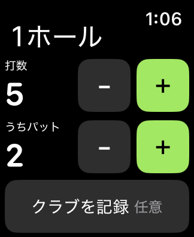

# Fairway — Watchで使う最小ゴルフカウンター

2026-10-25。現行の開発版は0.4.0。対象はiPhone 16e／Apple Watch Series 7、最低iOS 17／watchOS 10です。

Watchへの導入を優先し、GPS・地図を外しました。打数、パット、ホール別スコア、前半・後半の集計、任意のクラブ記録に絞っています。Watch単体で9／18ホールを開始でき、各操作は端末に自動保存します。同期はホールを離れたときなどにまとめ、常時測位・ポーリングは行いません。過去版の保存データは引き続き読み取れます。

[0.4.0の変更・互換性・検証範囲](docs/APP_0.4.0.md)

## 操作

- 「打数」「うちパット」の各行で、−／＋を押して変更します。パットの＋は打数にも1打を加えます。
- Watchでは横スワイプでホールと集計を切り替えます。
- 「クラブを記録」→打目→大きなクラブボタンを選ぶと、自動保存して前の画面へ戻ります。
- 主なクラブは1W・5W・6UT・5I・6I・7I・8I・9I・PW・PT。PTの選択だけではパット数を増やしません。
- 保存一覧の「見る・修正・削除」から、ホールごとの修正とラウンド削除ができます。削除前に確認します。
- 各操作は自動保存します。iPhoneとWatchは同じ新版へ更新してください。

## 導入状況と個人用SideStore試験版

2026-10-25、利用者が0.3.0をWindowsのWatch Loaderから導入してWatch起動に成功。その後、iOS系プロファイル対応版の改修SideStoreからもFairwayを導入し、**iPhoneだけでの手動Refreshと、その後のWatch起動に成功**したと報告しています。

現在動いているSideStore 0.7系のログイン・証明書を利用するため、個人用のWatch対応改修を開発しています。元の認証処理とアプリ識別子を維持し、Watchの端末登録、専用profileの取得・検査、親子IDの書き換え、個別署名、Watchを含むアプリのRefresh時の再署名を追加します。

0.4.0は44件のネイティブテスト・実機ビルド・40mmシミュレーター確認済みですが、更新後の実機動作は未確認です。

この改修は公式SideStoreではありません。自動更新は利用者が設定済みですが、**実際の自動実行と旧署名の期限後の起動は未確認**です。他アプリ・他環境の成功も個別に検証します。

- [導入手順](INSTALL.md)
- **[今後のAI・他アプリ向け：再利用用手順・コード・試行錯誤の記録](docs/watch-sideloading/README.md)**
- [個人用SideStoreのソース・ライセンス・ビルド手順](tools/watch-support/SOURCE.md)
- [調査と改修箇所](docs/SIDESTORE_WATCH_FEASIBILITY.md)
- [追加検証と導入方法の比較](docs/WATCH_RECHECK.md)
- [Watch対応iloaderの認証失敗の詳しい調査](docs/ILOADER_AUTH_INVESTIGATION.md)
- [Windows用Watch対応iloader・認証更新試験版の結果](docs/WATCH_AUTH_LOADER_RESULTS.md)
- [証明書上限7460への対応：通常版iloaderの署名鍵を再利用](docs/WATCH_LOADER_CERTIFICATE_REUSE.md)
- [現行版の検証範囲](docs/VALIDATION.md)
- [0.2.0の開発記録](docs/README_0.2.0_ARCHIVE.md)

## ビルド

FairwayはXcodeとXcodeGenでビルドします。GitHub Actionsの `ios.yml` がテストとiPhone／Watchの実機向けビルドを行い、未署名IPAを作成します。ローカルコマンドは `bash scripts/build_ipa.sh`。出力は `build/Fairway-0.4.0-unsigned.ipa` です。

SideStoreの個人用試験版は `sidestore-watch.yml` で固定した公開ソースに `tools/watch-support/apply.py` を適用して作成します。Appleのパスワード・証明書・端末IDをCIへ渡すことはありません。対応する改修ソースもIPAと一緒に生成します。WindowsのWatch情報ツールは `watch-info.yml` で作成します。
