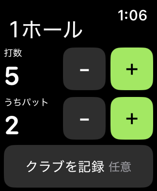

# Fairway + Watch-enabled SideStore

**iPhoneからApple Watchへアプリを導入し、PCをつながずに期限更新するためのSideStore改修と、ゴルフスコアアプリFairwayです。**

Windowsで初期準備後、無料Apple Accountを使い、改修版SideStoreからFairwayのiPhone版・Watch版を導入できました。実機でFairwayのRefreshと、その後のWatchでの利用も確認しています。iPhoneのショートカット／オートメーションで更新する運用を想定しています。自動実行の継続記録と旧署名期限後の動作は、今後の検証項目です。

This repository contains a working personal SideStore modification for installing and re-signing an embedded Apple Watch app from an iPhone, plus Fairway, a small golf score counter. Initial setup used Windows and a free Apple Account. The device owner confirmed installation, manual refresh, and Watch operation after refresh. Contributions and reproducible device reports are welcome.

This is an independent, AI-assisted experiment. It is not an official SideStore release or an endorsement by Apple or SideStore. Success is confirmed for Fairway in the reported setup; other apps and capabilities need their own validation.

**[ダウンロード：IPA・対応ソース・SHA256](https://github.com/iwamoto0414yuuki-droid/Fairway/releases/tag/v0.4.0-watch-refresh)**

## Start here / まず読む

- **[導入・再利用・ビルドの完成版手順](docs/watch-sideloading/REUSE_GUIDE.md)**
- [公開情報と検証範囲](docs/PUBLIC_RELEASE.md)
- [実機結果・固定した上流ソース](docs/watch-sideloading/state.json)
- [改善に参加する](CONTRIBUTING.md)
- [署名・依存コードのライセンス](tools/watch-support/SOURCE.md)

## Fairway

Watchで打数・パット数を入力し、ホール別スコア、前半／後半の集計、任意のクラブ記録を管理します。保存済みラウンドの修正・削除、iPhoneとWatch間の同期に対応します。GPSや常時ポーリングを外し、省電力を重視しています。

[0.4.0の変更内容とテスト](docs/APP_0.4.0.md)。Fairway本体はXcodeGenで生成し、`scripts/build_ipa.sh` または `.github/workflows/ios.yml` で未署名IPAを作成します。

## How the SideStore modification works

1. Obtain and validate Watch-specific development profiles using the existing account and certificate.
2. Rewrite companion bundle relationships consistently and sign Watch bundles individually.
3. Establish a separate Remote Pairing tunnel to the iPhone companion proxy and verify the Watch identity.
4. Prepare Watch-specific trust once and store the record in the iPhone Keychain for reuse.
5. Transfer the signed Watch app through streaming zip conduit and wait for the final install response.
6. Re-sign and reinstall both companions during Refresh. Preserve stable App Group identifiers across repeated refreshes.

The implementation does not automatically uninstall the Watch app or revoke certificates. Keep application identifiers and the signing team unchanged when updating existing apps. Never share pairing files, keys, passwords, device IDs, or provisioning profiles.

## Reproduce the tested build

The original successful runtime source is commit `cc13860`. The tag `watch-refresh-verified-20261105` adds documentation to that baseline. The same build and patches are retained on the public main branch.

Run **Build experimental SideStore with direct Watch installation**, file `.github/workflows/sidestore-watch-probe.yml`, from GitHub Actions on your fork. A Mac runner builds the unsigned IPA and its corresponding modified source. No Apple credentials are required by CI. Installation and signing use your own account on your devices.

Apply overlays in the order shown in the [reuse guide](docs/watch-sideloading/REUSE_GUIDE.md). Upstream revisions are pinned; patches fail if the expected source differs. Do not silently update dependencies or use the older `sidestore-watch.yml` build as the completed version.

## Verified failure and fix

Repeated Refresh appended the signing team suffix to the App Group identifier over and over. Apple then rejected creation of the accumulated group with a generic -1 error. `apply_group_refresh_fix.py` prevents repeated appending and repairs Fairway's known duplicate suffix. Regression coverage checks repair and 30 repeated transformations. See [the diagnosis](docs/watch-sideloading/REFRESH_APP_GROUP_SUFFIX.md).

The final build passed 8 native bridge tests and 27 signing tests. Fairway 0.4.0 has its separate app tests. CI success is distinguished from the device owner's successful installation and refresh reports.

## License

AGPL-3.0-or-later for newly published project code and the SideStore overlays, except components carrying their own notices/licenses. Original third-party notices remain in force. The independent Windows helper and Loader-derived components retain their documented licenses. See [LICENSE](LICENSE) and [SOURCE.md](tools/watch-support/SOURCE.md). Redistribution of modified SideStore binaries must include the corresponding modified source and upstream license notices.

Historical investigation documents describe earlier failed attempts. Use the current reuse guide and state.json for the final result. Local build directories, user conversations, device photographs, real scores and credentials are not part of this publication.
