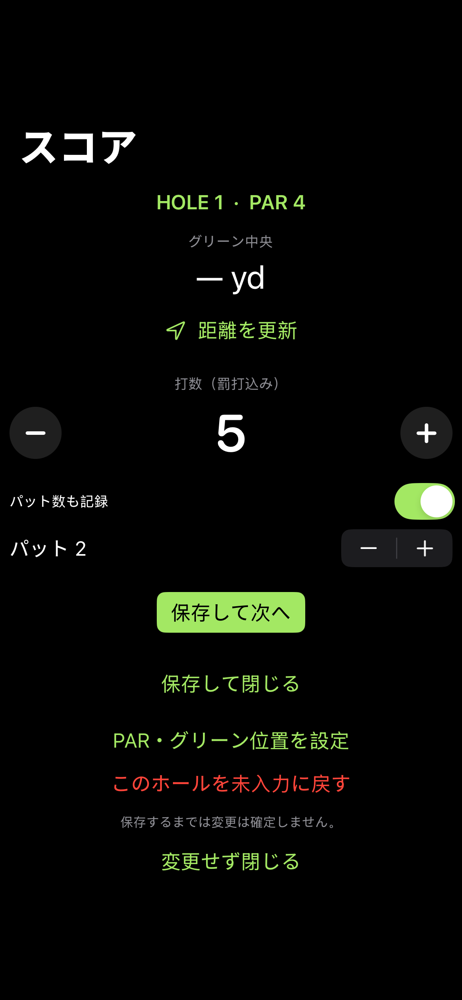

# Fairway 0.1.0 検証結果

2026-10-24。[成功したGitHub Actions実行](https://github.com/iwamoto0414yuuki-droid/Fairway/actions/runs/40087585760)。

- 検証済みアプリソース: `ffad16bde815faee271e9cf422ca72bc6d88f1ae`
- ネイティブXCTest: **20件、失敗0件**。モデル15件、保存4件、iPhone画面描画1件。
- XcodeGen生成、iOS/watchOSシミュレーター向けコンパイル、iPhone/Watch実機向けReleaseビルド: 成功。
- iPhoneのホーム・スコアカード・スコア入力を1170×2532 pxで取得。画像の空白検出を含む検証に通過し、画像を目視確認。
- Apple Watch SE 第2世代40mmシミュレーターの324×394 px画像を確認。最初の画面に打数・−/＋・保存ボタンが収まる。これはSeries 7実機での確認ではない。
- IPA内に実機用のiPhone/Watchネイティブ実行ファイルを確認。Watchの同梱、プラットフォーム、親子Bundle IDを検査。
- ダウンロードしたCIアーカイブのSHA256をGitHub提供値と照合。IPAもCIチェックサムと照合。

配布ファイル: `Fairway-0.1.0-unsigned.ipa` / **508,840 bytes**。

IPA SHA256:

```text
e2e1663125725c0ed00dc7b89349de76a2af671cdb52d7e66290c210ad842939
```

アプリソースの最終変更後、再テストと再ビルドを行った。上記コミット後の変更は説明文と検証画像のみ。

## 実機で未確認の項目

- SideStoreでの再署名・iPhoneへの導入と、Watchへの付属アプリ導入。
- ペアリングした実機でのWatchConnectivity転送と切断・再接続。
- 屋外GPSの精度、許可・拒否・測位停止・タイムアウト。
- 18ホールでの電池消費、Series 7の実際の操作性。
- MapKitのゴルフ場検索・グリーン指定を実機で操作する受け入れ確認。

これらの未確認項目を、モデルの自動テストやビルド成功で代用したとは扱わない。具体的な受け入れ手順は [検証計画](VALIDATION.md)、導入方法は [INSTALL](../INSTALL.md)。

## 確認した画面



