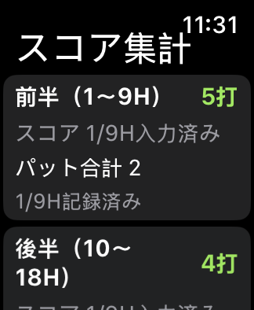
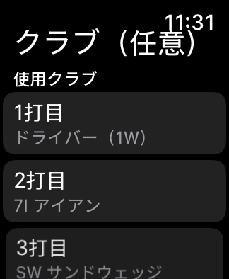
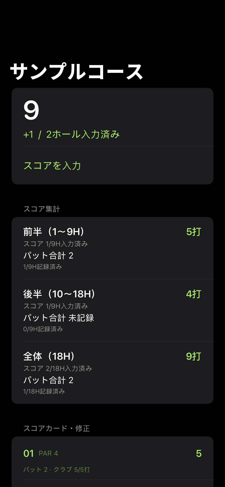
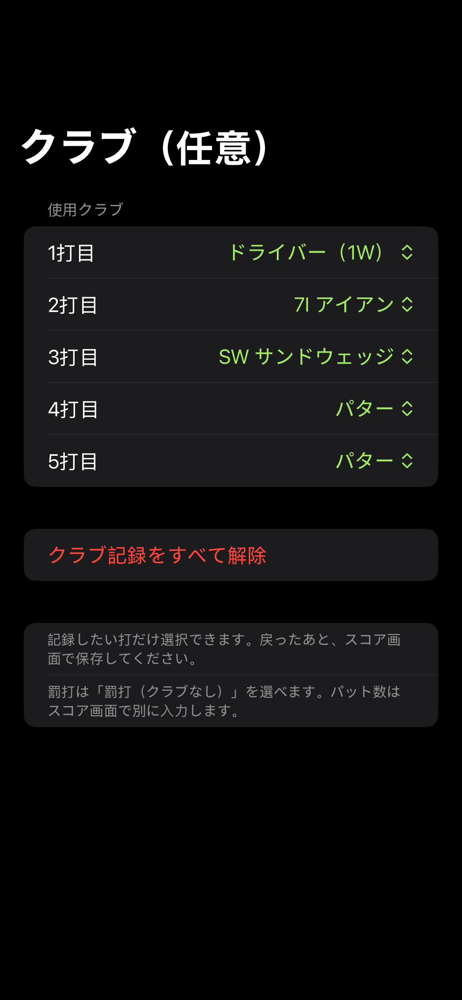

# Fairway 0.2.0 検証結果

2026-10-24。[成功したGitHub Actions実行](https://github.com/iwamoto0414yuuki-droid/Fairway/actions/runs/40089461199)。

- 検証済み実行コード: `c573335c98e8f2b3f9510c8e7b71755685fe7393`
- ネイティブXCTest: **30件、失敗0件**。既存20件と更新機能10件。
- iPhone/Watchシミュレーター向けコンパイル、実機向けReleaseビルド: 成功。
- iPhoneのホーム・集計付きカード・スコア・クラブ選択の4画像を取得。画像の空白検出を通過。
- 40mm Watch SEシミュレーターで打数、集計、クラブの3画面を取得。
- 前後半・全体のスコア、パット記録数と未記録表示、クラブの選択肢、打数・保存の初期表示を画像で確認。
- 0.1.0形式のJSON読込・追記、クラブ記録の再起動保持、別ホールのオフライン編集のマージ、コース再利用時にクラブを引き継がないことをテスト。
- 最大18H×30打のクラブを保存しても送信JSONは60KB未満。GPS・同期処理の実行コードに変更なし。

## 最終パッケージ

配布: `Fairway-0.2.0-unsigned.ipa` / **582,670 bytes** / バージョン **0.2.0** / ビルド **2**。

CI出力ではXcodeGen既定のInfo.plistバージョン1.0/1が残っていたため、未署名IPAのiPhone/Watch双方のInfo.plistについて、バージョン番号2項目だけを最終パッケージ処理で0.2.0/2に揃えた。`finalize_metadata.py` は対象の2つのplist以外の全ファイルについて、CI出力と1バイトも変わらないことを検証する。実行コード・資産・親子Bundle IDは変更していない。今後のXcodeGen生成でも同じ番号になるよう、project.ymlのInfoプロパティを明示した。

CIの元アーカイブはGitHubのチェックサムと照合済み。元の未署名IPAと最終配布IPAの両方のハッシュを `release/verification.json` に記録した。最終配布物では、実機プラットフォーム、Mach-O実行ファイル、Watch同梱、親子Bundle ID、両アプリのバージョン・ビルド番号を再検査した。

最終配布IPA SHA256:

```text
5a9786d519dc59ed9adaccbdc65e982b787b69c99ee635aa9b71ebdade07ec66
```

## 実機で未確認

SideStoreからの上書き更新・Watch導入、ペアリングした実機での同期、屋外GPS、電池消費、実機の操作性。自動テスト・シミュレーター画像確認をこれらの代わりには扱わない。クラブの選択から測位や通信を開始する実装はなく、従来どおりスコア保存時にまとめて転送する。

## 確認した画面










旧版の記録は [0.1.0検証結果](RESULTS_0.1.0.md)。操作・更新手順は [INSTALL](../INSTALL.md)。
